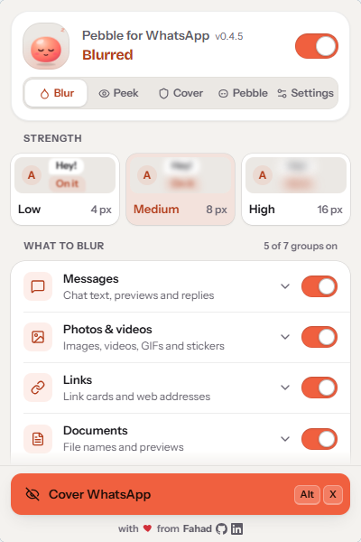
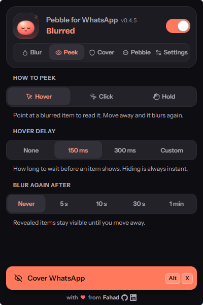
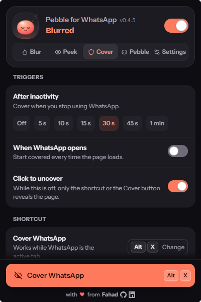
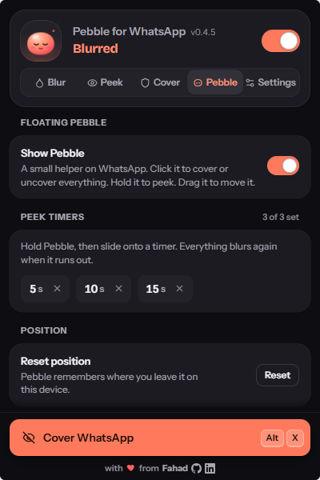
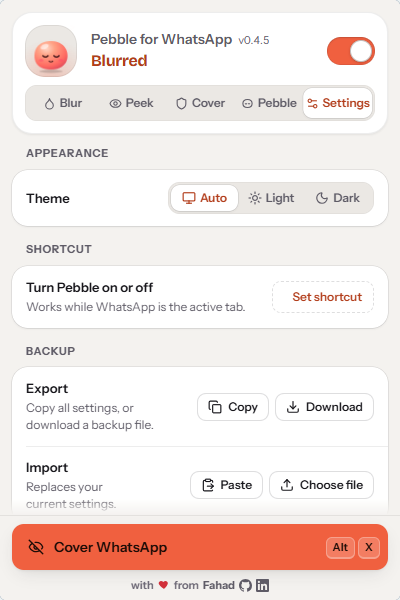

<div align="center">

  

  # Pebble for WhatsApp

  A Chrome extension that blurs the private parts of WhatsApp Web.
  Peek at one item when you need it, or cover the whole page with one shortcut.

  [](#features)
  [](#install)
  [](LICENSE)
  [](#testing)

  [Install](#install) · [Features](#features) · [Privacy](PRIVACY.md) · [Development](#development)

</div>

<div align="center">
  <picture>
    <source media="(prefers-color-scheme: dark)" srcset="docs/screenshots/blur-dark.png">
    
  </picture>
</div>

| Peek | Cover | Pebble |
| --- | --- | --- |
|  |  |  |

<div align="center">
  <picture>
    <source media="(prefers-color-scheme: dark)" srcset="docs/screenshots/settings-dark.png">
    
  </picture>
</div>

Pebble blurs messages, photos, names, link previews and other content on
web.whatsapp.com. When you need to read one message, peeking lifts the blur
for that item only. When you need the whole screen clear, the cover hides
everything behind one shortcut. All settings stay on your device.

## Features

- **One strength for the page.** Pick Low, Medium or High and see a live
  sample of the real blur. Every item and the page cover use the same value.
- **Per-group control.** Seven groups covering 27 content types, among them
  Messages, Photos & videos, Names, Link previews and Documents. Each group
  has its own switch; open it to switch single items.
- **Peek modes.** Hover, Click or Hold. Hover has an adjustable delay.
  Auto-hide re-blurs a revealed item after a set time.
- **Videos pause while blurred.** Chat videos resume only when you reveal
  them, and playback never gets cut mid-watch.
- **Cover.** One button or one shortcut, Alt+X by default. Cover can also
  engage on page load or after inactivity, and stays on until you release it.
- **An on-page helper.** A small coral character sits on the page. Click it to
  reveal everything without changing your settings. Hold it to peek. Slide
  onto a timer and everything blurs again when the time runs out. Drag it
  anywhere.
- **Themes.** Light, dark, or follow the system.
- **Keyboard support.** Tabs, radio groups and shortcut recording work
  without a mouse.
- **Backups.** Copy or download your settings as JSON, restore by paste or
  file.

## Install

### From the Chrome Web Store

Not published yet. The listing text is in
[docs/store-listing.md](docs/store-listing.md).

### From source

1. Download or clone this repository.
2. Open `chrome://extensions` (or `edge://extensions`).
3. Turn on Developer mode.
4. Click **Load unpacked** and pick the `extension/` folder.
5. Open WhatsApp Web. Pebble's icon appears in the toolbar.

Requires Chrome or Edge 123 or newer.

## How it works

The popup is the only settings screen. A card at the top shows the current
state: off, blurred or covered. Pebble, the mascot, acts it out. It sleeps
while blurring, stays awake when off, and wears a sleep mask while covered.
Five tabs below hold Blur, Peek, Cover, Pebble and Settings.

- Hover over a blurred item to read it, or choose Click or Hold under Peek.
  Moving away or scrolling blurs it again. With Hold, press for 300 ms to
  read. A short click still opens the item, and the click that ends a hold is
  ignored.
- The button at the bottom of the popup covers WhatsApp. It shows the cover
  shortcut. When covered, it uncovers.
- The cover state survives reloads and re-covers after navigation.
- Every change saves at once through the worker's ordered queue. Closing the
  popup never drops a pending change.
- Turning Pebble off releases every blur and the cover, and keeps your
  settings.

## Privacy

Pebble applies CSS to the page. It does not read, copy or send your messages.
There is no telemetry, no remote code and no external requests. Settings live
in your browser's extension storage. Full policy in
[PRIVACY.md](PRIVACY.md).

### Permissions

| Permission | Why |
| --- | --- |
| `storage` | Save your settings on your device |
| `scripting` | Apply the blur styles to the page |
| `https://web.whatsapp.com/*` | The only site the extension runs on |

## Development

After a source change, reload the extension and refresh WhatsApp.

```powershell
node dev/browser-check.cjs
```

Open the printed local URL and click Run browser checks. The harness serves
the real extension scripts and styles with sample markup and isolated test
storage. Chrome APIs are simulated; rendering, transitions and media playback
are real. Keep the test tab in front.

### Testing

| Suite | Command | Expect |
| --- | --- | --- |
| Browser checks | `node dev/wa-e2e/run-harness2.mjs` | 75/75 |
| Lifecycle | `node dev/wa-e2e/run-harness-extra2.mjs` | 9/9 |
| Pointer and animation | `node dev/pebble-check.cjs --edge` | 22/22 |

The pointer suite needs Playwright. Install it next to this repository
(`npm install playwright`), or set `PEBBLE_PLAYWRIGHT_ROOT` to a directory
containing Playwright:

```powershell
$env:PEBBLE_PLAYWRIGHT_ROOT = "path\to\playwright-project"
node dev/pebble-check.cjs --edge
```

The `dev/wa-e2e/` tools work against a logged-in account; see
[dev/wa-e2e/README.md](dev/wa-e2e/README.md). After loading a new build, also
check the installed extension on a logged-in WhatsApp. Selector match counts
alone do not prove privacy.

### Icons

The icon source is `design/icon/`. Render all sizes with Edge:

```powershell
node dev/render-icons.mjs
```

## Project structure

```
extension/            The extension. This folder is the whole package.
  manifest.json
  sw.js               Cover state, badge, ordered save queue.
  shared.js           Settings model, group/item tree, validation, shortcuts.
  content/            Reveal engine and the on-page helper.
  popup/              The popup: HTML, CSS, wiring.
  ui/                 Shared controls, tokens, store, icon set.
  css/features/       Per-surface blur styles.
design/               Icon source SVGs.
docs/                 Screenshots, store listing, e2e checklist.
dev/                  Test harnesses and local tools. Not shipped.
```

## License

[MIT](LICENSE)

<div align="center">

  Made with ♥ by **[Fahad](https://github.com/fahadmalik5509)**

  [](https://github.com/fahadmalik5509)
  [](https://www.linkedin.com/in/fahadmalik5509)

</div>
